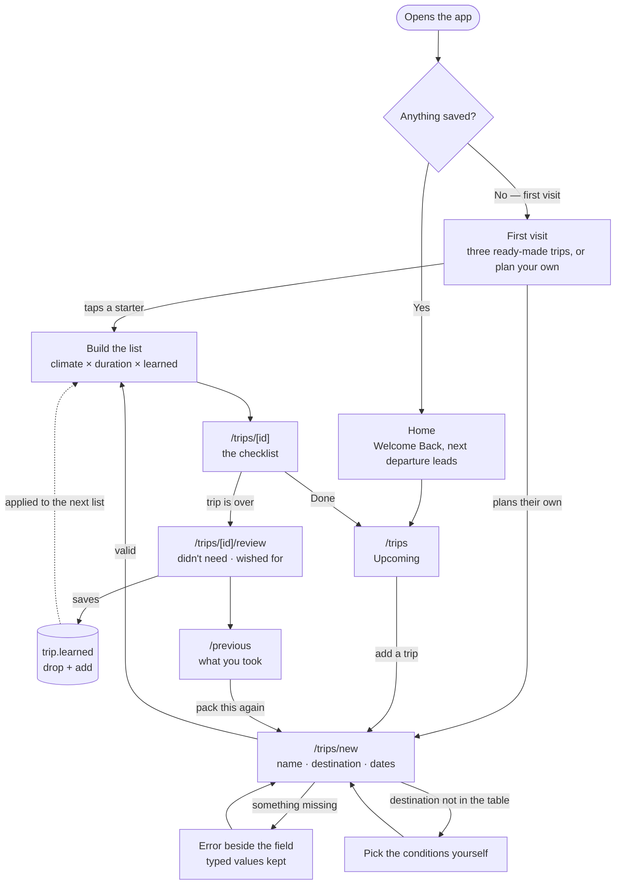
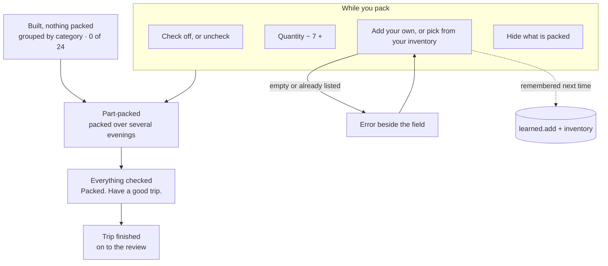

# Wanderlist

Packing lists for your favorite destinations.

You keep the trips you take again in one place — Thanksgiving at your parents', a
conference in New York, Lisbon in March. Each one builds its own packing list from your
dates and the weather where you're going *that month*. Afterwards you say what you didn't
need and what you wished you'd brought, and the next time you pack that trip, the list
starts already corrected.

Built for **Design, Build, Ship · MPCS 51238**. Assignment 3 designed the flows and the
interface; **Assignment 4 (Full Stack App)** put accounts, a database and one external API
underneath them, which is what makes the list follow you from the laptop you planned on to
the phone beside the suitcase.

- **Live:** https://wanderlist-mocha.vercel.app/ — production follows `main`
- **Assignment 3's build:** https://departure-board-nine.vercel.app/ — a separate repo,
  still up, no accounts and no backend
- **Flows:** [`flows.md`](./flows.md) · **Onboarding research:** [`research.md`](./research.md)
- **Agent context:** [`AGENTS.md`](./AGENTS.md)

## The core task, as one sentence

> I add a trip → it builds a packing list from the dates and the destination →
> I check things off as I pack → I come back next time and it's already corrected from
> last trip.

## The three flows



**First visit.** Nothing is saved, so there is nothing to show — which is exactly the dead
end the brief warns about. Instead the front door offers two equal routes: pick one of
three ready-made trips, or plan your own. One tap on a starter creates a real trip with
real dates and a real packing list, before a single field is filled in.

Assignment 3 sat a worked example underneath them — a trip already packed twice, its
corrections shown inline — on the argument that the correction loop takes two trips to
demonstrate and a first visit can't otherwise show it. It's gone: it was a fourth thing
competing for the first screen, and signed out it walked people into a trip that had
never been saved. The loop is now explained in words and shown by the second trip anyone
actually takes.

**Coming back** happens on three clocks. Mid-pack, because packing takes several evenings
and a part-packed list is an invitation to finish it. Before the trip, because home and
Upcoming both lead with the next departure and what's still unpacked. After it, because a
short review feeds `trip.learned`.

That dashed arrow is the whole idea: a trip you repeat should cost less to pack the second
time than the first.

## The checklist

The checklist is the product — trips are just the container. It lives entirely on
`/trips/[id]`: one route, four states, four actions.



Part-packed is a first-class state rather than an in-between: packing over several
sessions is the shortest-cycle reason anyone reopens this app, so Upcoming surfaces it
("Lisbon — 7 items left") and the list reopens exactly where it was left, filter included.
A quiet **Saved** appears beside the tally whenever the list changes, because every tick
is written immediately and nothing otherwise said so. It means the same thing it always
did; what's behind it changed, from one key in `localStorage` to a row in Postgres.

Both directions teach the list. Add an item by hand and it goes to `learned.add` *and*
your inventory; remove a suggested one and it goes to `learned.drop`. After two or three
runs of a trip, the list has converged on what you actually pack.

## A page per step, with shared navigation

Four tabs in the masthead — New trip, Upcoming, Previous, Inventory — so where you are is
always legible. Starting a trip comes first because it's what people arrive to do; the
other three are ways of looking at trips that already exist.

| Route | Flow | What it is |
|---|---|---|
| `/` | First visit · coming back | Home. A new person gets the onboarding here — three ready-made trips or their own, one tap to a real list. Returning, it says **Welcome Back** and leads with the next departure. |
| `/trips/new` | Core task | The form. Also serves `?from=<id>` to repeat a finished trip with its corrections already applied. |
| `/trips` | Coming back | **Upcoming Trips.** Soonest first, each showing what's left to pack. |
| `/trips/[id]` | Core task | **The checklist.** Category sections with their own tallies, quantity steppers on every row, a "hide what's packed" filter that survives a reload, and a **Done** exit. |
| `/trips/[id]/review` | Coming back | Two questions after the trip, which write `trip.learned`. |
| `/previous` | Coming back | **Previous Trips.** What you took, what each taught the next list, and "Pack this again". |
| `/inventory` | Coming back | **Your Inventory.** Everything you own: things you list yourself plus everything trips reveal, each with a quantity. Sorts by **Packed most**, or filters to **Never used** — on a list at least once and never actually packed. Also lists what you took on each finished trip. |

Categories are open-ended. The seven defaults cover most packing, but both add-item forms
end in "A new category…", and an invented category gets its own colour derived from its
name.

## Quantities

A packing list has always counted — "Socks × 6" — but the inventory didn't, so owning two
t-shirts was a thing you couldn't say. Worse, the obvious way to say it (type "T-shirt"
again) was rejected as a duplicate. The two halves of the app disagreed about what an item
*is*: a line on a list has a number, a thing you own apparently doesn't.

Now every inventory row has a quantity, set with the same stepper the checklist uses. The
number comes from one of three places:

| | Where it comes from |
|---|---|
| **Counted** | You set it — the **How many** field when adding, the stepper on the row afterwards, or the **1** both of those start at. |
| **Inferred** | The most you've ever *packed at once*. Tick "Socks × 6" off a list and you demonstrably own six pairs. Shown as "You've packed 6". |
| **Assumed** | `1`. It's been on a list but never ticked, so there's no evidence either way. |

The add form carries a **How many** field under the category, and like the category it
applies to everything in that submission — add "Rain shell, Hiking boots" and both land in
one place at one count. It starts at **1**, which is what most things are, and anything you
add keeps that 1 until you change it: someone who adds a thing and leaves the number alone
has still told you something. A row the app worked out from your trip history is different
— that 1 was nobody's idea, so it stays quiet.

Listing something already there adds up rather than erroring. With **How many** at 1 that
means *one more* (`Socks → 3`); set it above 1 and it's taken as the count itself.

A count you set never gets in the way of one you've proved: **the row shows the greater of
the two.** Accept the 1 on "Socks", then tick "Socks × 6" off a list, and the row corrects
itself to 6. The stepper won't go below that floor either. So a hasty 1 costs nothing — it
fixes itself the first time you actually pack the thing.

The payoff is on the checklist: when a list asks for more than you own, the row says
**"You own 1"** under the label. That only fires on counted and inferred numbers. Assumed
ones stay silent — otherwise a new person's very first list, generated against an empty
inventory, would warn on every row that asks for more than one.

## How the list gets built

No forecast is fetched, and that's a choice rather than a limitation: a trip you repeat is
usually planned well past any forecast horizon, so the real question is "what is March
usually like in Lisbon", not "what's the weather on the 14th". The numbers come from
fifteen years of Open-Meteo's archive, averaged per calendar date — see **Accounts, data
and the one API** below. [`src/lib/climate.ts`](./src/lib/climate.ts) still ships
approximate monthly normals for 33 destinations, which is now the fallback for when the
lookup can't answer rather than the only source.

`buildPackingList` combines three inputs:

| Input | Effect |
|---|---|
| Trip length | Quantities — socks and underwear scale with nights, capped at ten |
| That month's climate | Outerwear, rain gear, sun gear; a freezing low is treated differently from a merely cold day |
| `trip.learned` | Drops what you didn't need, adds back what you asked for |

A trip spanning a month boundary packs for the harder half — the colder high and the
wetter month — rather than the average.

Every trip states where its weather came from: a badge naming the month and the place, a
one-line summary, and then a cell per day of the trip — weekday, a glyph, the daytime high
and the overnight low, tinted by what kind of day it usually is. The strip's header says
once that these are averages across fifteen years rather than a forecast, instead of
repeating a disclaimer on every cell. That labelling came out of the research: PackPoint
mixes live forecasts with climate averages and had to start marking which one you're
looking at.

The destination photos are static Wikimedia CDN references, resolved once by hand and
each verified; the app never calls an API for them. Where there's no photo, `DestinationArt`
draws a poster generated *from the climate data*, so an unfamiliar destination still gets
an image that means something.

## Accounts, data and the one API

Three pieces went in underneath Assignment 3's interface, and the interface barely moved —
every route still reads its data through one `useTrips()` hook, which is what made the
swap survivable.

**Accounts — Clerk, on development keys.** [`src/proxy.ts`](./src/proxy.ts) turns away a
signed-out visitor at every route that touches somebody's data; the masthead tabs are
hidden rather than shown as locked doors. Exactly three routes are public — `/`,
`/sign-in` and `/sign-up` — allow-listed rather than enumerating the private ones, so a
route added later is protected by default. Home is on that list because the first visit
*is* the onboarding and a sign-in wall in front of it would be a dead end with a form on
it; it shows nothing personal, which is what the requirement is actually about. (`/trips`
carries the same starter cards, but only for someone signed in with nothing saved yet.) A
starter card works signed out too: it links to `/trips/new?starter=<key>`
instead of writing a row, the query survives the sign-in redirect, and the trip is waiting
afterwards rather than lost.

**Data — Supabase, with row-level security on every table.** `trips` and `kit_items` are
fenced per person; `climate_cache` is shared reference data nobody owns.

Clerk user ids are strings (`user_2abc…`), not UUIDs, so `user_id` is `text` and every
policy compares against the JWT's subject claim rather than `auth.uid()`:

```sql
(auth.jwt() ->> 'sub') = user_id
```

Each of the two per-user tables has all four policies, and insert and update carry a
`with check` as well as a `using` — without it, `using` alone would let someone write a
row stamped with another person's id. `climate_cache` is the deliberate contrast:
readable by any signed-in user, and writes refused by an explicit `with check (false)`, so
the refusal is visible to anyone reading `pg_policies` instead of looking like a missing
policy. Only the server writes it, holding the service role.

That split is why there are three Supabase clients, and the distinction *is* the
access-control story:

| Client | Runs | Identity it carries |
|---|---|---|
| [`src/lib/supabase.ts`](./src/lib/supabase.ts) | browser | the caller's Clerk token |
| [`src/lib/supabase-server.ts`](./src/lib/supabase-server.ts) | route handlers | the caller's Clerk token |
| [`src/lib/supabase-admin.ts`](./src/lib/supabase-admin.ts) | server only | the service role — exactly one insert, into `climate_cache` |

The third carries `import "server-only"`, so importing it from a client component fails the
build rather than shipping a service-role key to the browser. Nothing with a `user_id` ever
goes through it.

**The API — Open-Meteo, called on the server, and cached.** A lookup geocodes the
destination, then averages fifteen Octobers (or Marches, or whichever month the trip is
in) from the archive endpoint, per calendar date. It runs at
[`/api/climate`](./src/app/api/climate/route.ts) rather than in the browser for two
measured reasons: a cold lookup is fifteen sequential requests at about **5.3s**, the same
lookup served from `climate_cache` takes **741ms**, and Open-Meteo returned `429` after
roughly ten calls from one shared IP — their terms warn that platforms like Vercel are
throttled early. Normals for March in Lisbon are also identical for every user on the
planet, so one fetch should serve everybody. Caching shared, derived data is the whole
argument for putting the call there.

Four states are designed, and two of them are deliberately not the same thing:

| State | What you see |
|---|---|
| Loading | "Looking up what these dates are usually like in Lisbon…" |
| Found | the day strip, and the list built from those numbers |
| Nothing found | the destination isn't on the map — the input is the problem, so the fix is offered: a different spelling, or a nearby larger city |
| API down | the built-in table takes over and says so; nothing to act on, so nothing is asked |

The last two look alike and read completely differently: one is a typo, the other isn't
your fault. Collapsing them into "couldn't load weather" would blame the person for an
outage.

**The test.** [`e2e/isolation.spec.ts`](./e2e/isolation.spec.ts) signs two Clerk accounts
in, saves a trip from each, and asserts neither board shows the other's — a real browser,
a real session, a real Postgres with RLS on, because a unit test would only prove the SQL
says what I wrote. It was watched failing first: with the select policy loosened to
`using (true)` it reported `Expected: 0, Received: 1`, then passed again once restored
with identical app code. Both migrations are kept, because the pair is the evidence.

## Forms and their errors

Every error renders beside its own field, is phrased as an instruction, and **keeps what
the person typed** — validation only ever sets errors, never clears values. A failed
submit also moves focus to the first invalid field, so it's announced rather than merely
drawn.

| Where | Condition | Message |
|---|---|---|
| Trip name | empty | `Name this trip so you can find it again.` |
| Destination | empty | `Enter a destination.` |
| Start date | empty or unparseable | `Pick a start date.` |
| End date | empty or unparseable | `Pick an end date.` |
| End date | before the start date | `End the trip on or after it starts.` |
| Add item | empty label | `Name the item you want to add.` |
| Add item | already on the list | `Socks are already on this list.` |
| New category | empty name | `Name the new category.` |
| Inventory | nothing listed | `List at least one thing to add.` |
| Review | empty wish | `Name the thing you wished you'd brought.` |

A destination that isn't in the climate table is deliberately **not** an error — the form
reveals a conditions picker instead, so any destination in the world still works.

Listing something already in your inventory used to be an error too. It isn't any more: a
repeat means you own another one, so the count goes up and the form says `Socks → 3`. See
**Quantities** below.

## Tech

Next.js 16.4.2 (App Router), React 19.3, Tailwind CSS v4, Clerk for accounts, Supabase for
data, Playwright for the one test. Those are the whole dependency list — still no state
library, no form library, no date library, no UI kit and no icon package; the glyphs on the
day strip are hand-written SVG paths for the same reason. Deployed on Vercel's Hobby plan.

The design system is **Café Terrace**, carried over from Assignment 2 — parchment and
pressed ink under a red awning, 0px corners, hard-offset shadows, Fraunces and Source Sans.
Every control comes from one of three files (`Button`, `Field`, `Controls`); a grep for
`<button`, `<input`, `<textarea` or `<select` finds nothing outside them.

### Running it yourself

```bash
npm install
npm run dev          # http://localhost:3000
npm run build        # the check that actually catches things
npm run test:e2e     # the two-user isolation test
```

It needs a Clerk application and a Supabase project of your own. Put their keys in
`.env.local`, which is gitignored and which agents working in this repo are denied read,
write and edit access to — see `.claude/settings.json`. **No value below belongs in a
commit;** these are the names only:

| Variable | Where it's read |
|---|---|
| `NEXT_PUBLIC_CLERK_PUBLISHABLE_KEY` | Clerk's SDK, browser and server |
| `CLERK_SECRET_KEY` | Clerk's SDK, server — and `clerkSetup()` in the Playwright run |
| `NEXT_PUBLIC_SUPABASE_URL` | all three Supabase clients |
| `NEXT_PUBLIC_SUPABASE_PUBLISHABLE_KEY` | the browser and route-handler clients (`NEXT_PUBLIC_SUPABASE_ANON_KEY` is accepted too — Supabase renamed it, and which one you have depends on when you copied it) |
| `SUPABASE_SERVICE_ROLE_KEY` | `supabase-admin.ts` only, server-side, for the one cache insert |

Clerk and Supabase also have to be introduced to each other: Supabase's third-party auth
integration points at the Clerk instance, so Supabase verifies Clerk's token directly and
`auth.jwt() ->> 'sub'` resolves to the signed-in Clerk id. If that connection is missing
the app doesn't error — every policy matches nothing and the app simply looks *empty*.
Rule it out first when rows vanish.

The same five go in Vercel's environment variables. Migrations live in
[`supabase/migrations/`](./supabase/migrations) and run in filename order.

There's a **Reset to first visit** control in the footer, which is the quickest way to see
the onboarding again — it's otherwise unreachable once you've saved a trip. It now deletes
rows from your account rather than clearing one browser, which is why it asks twice.

## Accessibility

Keyboard operation, real labels and error association are built into the `Field` component
rather than added afterwards — every control gets an `id` and the matching
`aria-describedby` from the same place, so a field without a properly associated label is
awkward to write. Audited live: **19 controls on the checklist, 0 unlabelled**, and no
button without an accessible name.

**Text contrast was checked by computing WCAG 2.1 ratios** for all 49 text-and-background
pairs the app actually renders: every token on every surface it appears on, text on the
accent and ink fills, and each category pigment on its own tint. Four failed:

| Pair | Was | Needed | Now |
|---|---|---|---|
| `rule-strong` on the page background — every input and control edge | 2.63:1 | 3:1 (UI boundary) | **3.14:1** (`#90867C` → `#83796F`) |
| Clothing pigment on its tint | 4.23:1 | 4.5:1 | **4.89:1** (`#5F7048` → `#566642`) |
| Clothing pigment on the page background | 3.97:1 | 4.5:1 | **4.59:1** |
| Extras pigment on the page background | 4.50:1 | 4.5:1 | **4.63:1** (`#7A5E16` → `#785C16`) |

Each replacement scales HLS lightness only, so hue and saturation are untouched and the
palette still reads as one ink set. All 49 pairs now pass.

## First-run check — Assignment 3

Kept as written, so the record stays honest: this pass predates accounts and the database,
and reads `localStorage` where the app now reads Postgres. All four findings were fixed at
the time.

**Method, stated plainly:** the browser tooling available here can't attach to a remote
URL, so the live deployment was verified by request (every route returns 200, and the
served HTML matches `HEAD`) and the interactive pass was run against the same commit
locally. The findings are about the code, not the hosting.

The run was a brand-new user with empty `localStorage` and one goal: *going to Lisbon next
month, don't forget anything.* Four things came out of it, all since fixed.

**1 · Five primary buttons competed on the first screen.** The design system reserves the
accent fill for *the* primary action; the first visit had it on three starter cards, the
New trip button and "Open the example" at once, so nothing read as the main path. The New
trip button and the example are now secondary. Three remain, but they're one action
repeated across parallel cards, which is what a card grid is for.

**2 · A failed submit left focus on `<body>`.** Errors rendered correctly beside their
fields and typed values survived — but nothing moved focus, so a keyboard or screen-reader
user got no signal that the submit had failed and had to hunt the form for it. Added
`focusFirstError()` to the `Field` module and wired it into all four forms; focus now lands
on the first invalid field.

**3 · The home page's static HTML was empty.** It rendered a blank 256px placeholder until
storage had been read, so a new visitor on a slow connection got a blank screen before the
JS arrived — the dead-end empty screen in a different costume. The first visit is the
correct default for someone with nothing saved, and the `data-has-trips` gate already hides
it for returning people before paint, so it now ships in the prerendered HTML. The starter
*cards* can't be: their dates are relative to today, and Cache Components won't bake a clock
reading into a static shell. So the shell is the greeting, the proposition and the
instruction, and the cards arrive with the client.

**4 · The review only offered items that had been ticked as packed.** Found earlier in the
same pass: people tick a few things and pack the rest from memory, so a sixteen-item trip
with one ticked box offered exactly one thing to review. It also withheld the items most
worth retiring — the ones never packed at all. It now offers the whole list, each row
marked "you packed this" or "never packed".

**What I'd look at next, and didn't:** the three starter trips all resolve to similar
conditions ("Cool, some rain" twice, "Mild, some rain" once), so the first visit
under-sells the one thing that makes the lists differ. Picking destinations and dates that
span the range — something genuinely cold, something hot — would make the climate reasoning
visible in the first three seconds. Left alone because it changes the starter set rather
than the code.
