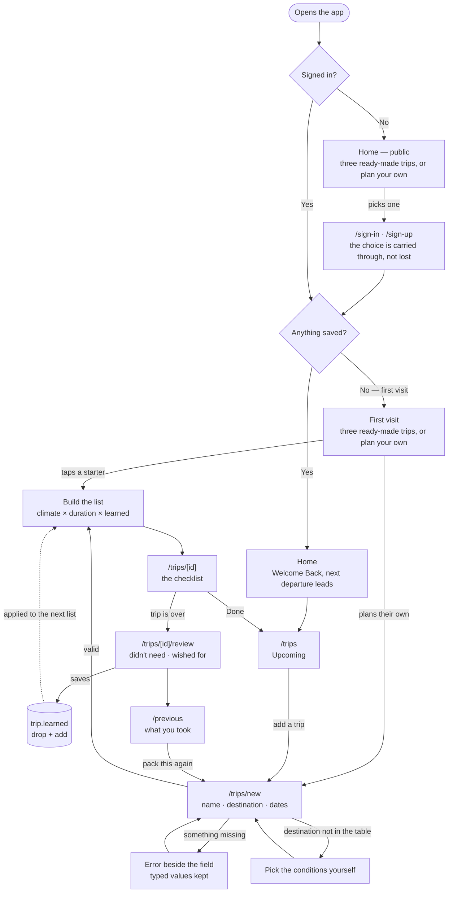
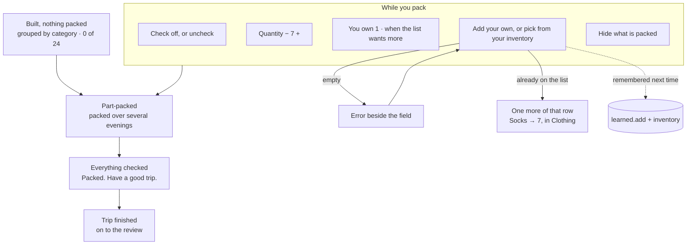

# Flows

Wanderlist is a packing list for trips you take again. Three flows carry it:
the first visit, the core task, and coming back.

The core task, as one sentence:

> I add a trip → it builds a packing list from the dates and the destination →
> I check things off as I pack → I come back next time and it's already corrected from
> last trip.

## The three flows

**First visit.** Nothing is saved, so there is nothing to show — which is exactly the
dead-end the brief warns about. Instead the front door offers two equal routes: three
ready-made trips, or plan your own. One tap on a starter creates a real trip, with real
dates and a real packing list you can change afterwards. Value arrives before a single
field is filled in.

Home stays public for that reason: a sign-in wall in front of the onboarding would be the
dead end with a form on it. It shows nothing personal. A signed-out visitor who picks a
starter is taken to `/trips/new?starter=<key>` rather than having a trip written for them,
and the query survives the sign-in redirect — so what they chose is waiting afterwards
instead of lost. Signed in, the same card builds the list on the spot.

**Coming back** has three reasons on three different clocks. Mid-pack, because packing
happens over several evenings and a part-packed list is an invitation to finish it. Before
the trip, because home and Upcoming both lead with the next departure and what's still
unpacked.
After it, because a short review feeds `trip.learned`, and the next run of that trip
starts already corrected.

Coming back now also means coming back *somewhere else*. Everything is per account in
Postgres rather than per browser, so a list planned on a laptop over several evenings is
the same list on the phone beside the suitcase — which is the whole reason accounts are
worth their cost here.

That dashed arrow is the whole idea of the tool: a trip you repeat should cost less to
pack the second time than the first.

## The checklist

The checklist is the product — trips are just the container. It lives entirely on
`/trips/[id]`: one route, four states, four actions.

Part-packed is a first-class state rather than an in-between. Packing over several
sessions is the shortest-cycle reason anyone reopens this app, so Upcoming surfaces it
("Lisbon — 7 items left") and the list reopens exactly where it was left, filter included.

Items group into sections by category, each with its own tally. Rows carried a per-item
reason once — "march in lisbon", "6 days" — and it went: the same line repeated down every
climate-driven row and said nothing the header hadn't already said better, since the header
states the month and the conditions once. The one thing a row still says for itself is
**"You own 1"**, when the list asks for more of something than your inventory has.

Both directions teach the list. Add an item by hand and it's written to `learned.add`;
remove a suggested one and it goes to `learned.drop`. After two or three runs of a trip
the list has converged on what you actually pack.

## How the list gets built

No forecast is fetched, and that's the right call rather than a limitation: a trip you
repeat is usually planned well past any forecast horizon, so the real question is "what is
March usually like in Lisbon", not "what is the weather on the 14th".

The numbers come from Open-Meteo's archive — fifteen years of that month, averaged per
calendar date — fetched on the server at `/api/climate` and cached in `climate_cache`,
because normals for March in Lisbon are identical for every user and the free tier
rate-limits per IP. Each day of the trip gets a cell: weekday, a glyph, the daytime high
and the overnight low. `src/lib/climate.ts` still ships approximate monthly normals for 33
destinations, now as the fallback for when the lookup can't answer rather than as the only
source.

From there `buildPackingList` in `src/lib/suggestions.ts` combines three inputs:

| Input | Effect |
|---|---|
| Trip length | Quantities — socks and underwear scale with nights, capped at ten |
| That month's climate | Outerwear, rain gear, sun gear; a freezing low is treated differently from a merely cold day |
| `trip.learned` | Drops what you didn't need, adds back what you asked for |

A trip spanning a month boundary packs for the harder half — the colder high and the
wetter month — rather than the average of the two.

## Error states

Every one renders beside its own field, is phrased as an instruction, and keeps what the
person already typed. A failed submit also moves focus to the first invalid field.

| Where | Condition | Message |
|---|---|---|
| Trip name | empty | `Name this trip so you can find it again.` |
| Destination | empty | `Enter a destination.` |
| Start date | empty or unparseable | `Pick a start date.` |
| End date | empty or unparseable | `Pick an end date.` |
| End date | before the start date | `End the trip on or after it starts.` |
| Add item | empty label | `Name the item you want to add.` |
| New category | empty name | `Name the new category.` |
| Inventory | nothing listed | `List at least one thing to add.` |
| Review | empty wish | `Name the thing you wished you'd brought.` |

A destination that isn't in the climate table is deliberately **not** an error. The form
reveals a conditions picker instead, so any destination in the world still works.

Adding something that is already there isn’t one either, on **either** form, which is the
point: a repeat means one more, not a mistake. The inventory form reports `Socks → 3`; the
checklist adds one to the row that exists and says where it is, `Socks → 7, in Clothing`.
Both used to refuse. The checklist’s refusal was worse than the inventory’s, because it
never said *which* section the row was already in — so on a twenty-item list you were sent
hunting for a thing the app could see and you could not.
